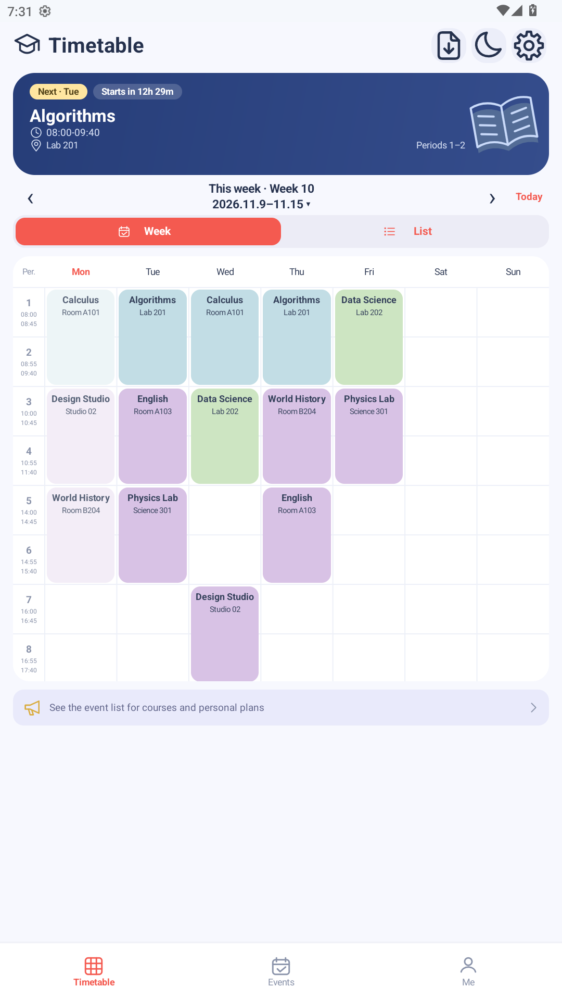
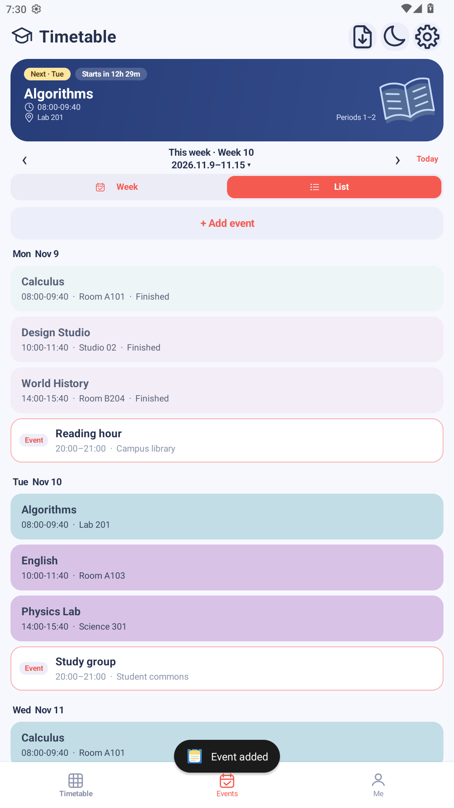
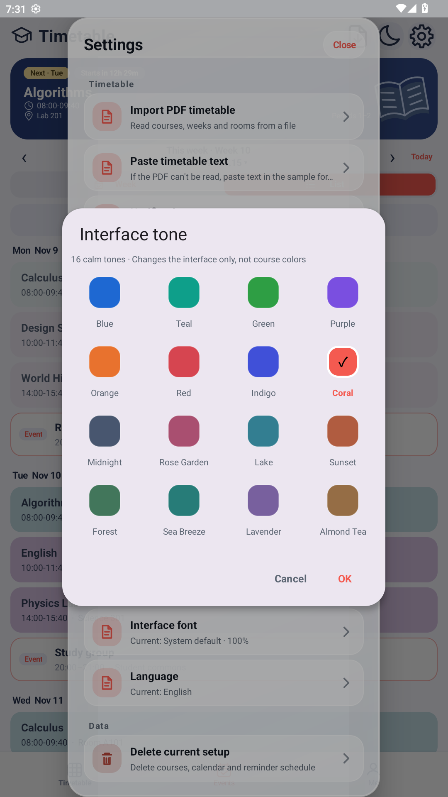

<div align="center">

# Week weeks

**Clean. Ad-free. Keep your attention on the week ahead.**

A native Android timetable and agenda app that works offline. No registration, advertising SDKs, or analytics tracking SDKs.

[简体中文](<README.md>) · [繁體中文](<README.zh-TraditionalChinese.md>) · **English**

[PolyForm Noncommercial 1.0.0](<LICENSE>) · Modifications allowed, commercial use not


</div>

## A timetable, not a distraction

You open your timetable to find your next classroom—not to watch an ad first.

- **Ad-free**: no launch-screen ads, banners, or rewarded videos. No waiting for an ad to finish before checking your classes.
- **No account required**: no phone number, email address, or login. Set your academic calendar and start adding classes.
- **Works offline**: the app does not request the `INTERNET` permission. Viewing your timetable, managing events, and local reminders do not depend on a network connection.
- **No analytics or tracking SDKs**: the current app integrates no advertising, user analytics, or behavioral tracking SDKs.
- **Your data stays on your device**: classes and events are saved in the app's private storage. Cloud sync is not provided.

> “Clean” means the current version is ad-free, has no account system, and includes no analytics tracking. It does not mean zero system permissions. Notification and exact alarm permissions are used only for local reminders; you decide whether to grant them.

## Meet Week weeks

<table>
  <tr>
    <td align="center"><br><strong>Your week of classes, at a glance</strong></td>
    <td align="center"><br><strong>There is life beyond classes</strong></td>
    <td align="center"><br><strong>Interface tones, your choice</strong></td>
  </tr>
</table>

*Images come from a separate demo installation. All classes, locations, and personal events are fictional examples; no real user timetable is included. The screenshot language does not limit the app language: Simplified Chinese, Traditional Chinese, and English are supported.*

## Simple, with the essentials covered

### Choose the content and how to view it

Choose a mode under Settings → Display content → Mode selection to control which content appears. Combined is the default, and the current choice is shown above the timetable.

| Content | What appears |
| --- | --- |
| Courses (Timetable mode) | Courses in the semester timetable |
| Events (Agenda mode) | Personal events, including dates outside the semester |
| Combined | Courses and personal events together |

**Week view** and **List** control the layout within the selected mode. Switching modes preserves the current date and layout, stored courses and events, and their reminders. “Me” provides a place to manage personal events.

### Timetable: from your next class to the whole semester

- Switch between week and list views, with Monday–Sunday support and classes spanning one or multiple periods.
- Browse teaching weeks, with odd-week, even-week, and custom week selections. Return to the current week with one tap.
- See current and upcoming class cards, countdowns to class start and end, and faded styling for completed classes.
- Customize period times, with 11 periods provided by default. Show teacher names when you need them.
- Tap a class for details, long-press to edit, and long-press an empty timetable cell to add a class—helping prevent accidental edits.

### Agenda: make room for life

- Create one-time, daily, weekday (Monday–Friday), or weekly events on selected days. An optional end date is inclusive. Edit just one occurrence or the entire series.
- Edit a course from its detail view or long-press a class card. Move one class to a different date or period, change its room, cancel that class, or edit the entire course. Reminders follow the actual class.
- Saving a class or event lists its overlaps with the other type of schedule. Scroll through all conflicts to see the date, time span, and overlapping minutes, then go back to edit or save anyway.
- In Agenda mode, Week view places events on a shared time axis and sizes cards to their duration. Short events and events without an end time keep a minimum visual span of 30 minutes; their saved times remain unchanged.
- Overlapping events use side-by-side cards when space permits. A count badge groups events when space is tight; tap it to choose from every event in the group. Counts over 99 appear as `99+`.
- Each day has an add button for that date. List view displays the selected content in time order.
- While editing, see the time range, duration, or “No end time set” immediately. Invalid times and an end time before or equal to the start time are explained beside the inputs.
- Choose preset or custom lead times for local reminders. The app can restore reminder schedules after a device restart or app update.

### Import: less repetitive typing

- Import text-based **PDF, XLSX, CSV, TSV, or TXT** timetables through the system file picker, without requesting broad storage read/write permissions. You can also paste timetable text.
- Preview the parsed courses, review individual entries, and confirm before saving.
- XLSX, delimited files and pasted text accept both course lists ([XLSX template](<docs/templates/timetable-list-template.xlsx>), [CSV template](<docs/templates/timetable-list-template.csv>)) and [weekly grids](<docs/IMPORT-PARSERS-20261119.md>) with weekday headings across the top and period numbers on the left. In XLSX, merge consecutive periods vertically in one weekday column. When pasting or exporting to text, write the range explicitly, e.g. `1-2`.
- Common Simplified Chinese, Traditional Chinese, and English column headings and weekday names such as `周一` and `Mon` are supported. See the [import guide](<docs/IMPORT-PARSERS-20261114.md>) and [parser compatibility notes](<docs/IMPORT-PARSERS-20261115.md>) for formats and limitations.
- Legacy `.xls` files must first be saved as XLSX or CSV. Arbitrary visual spreadsheet grids are not automatically recognized. PDF parsing depends on the document layout, and OCR for scanned documents is not supported.

### Appearance: clean, and personal too

- Light, dark, and system-default themes, with **22 interface accents** and 42 preset class colors. Interface accents and course colors are independent.
- Classes with the same name share a base color. You can also randomize colors by class-name groups.
- Use the system font or OPPO Sans, and adjust the app's text size from 85% to 125%. The OPPO Sans file is proprietary (about 21.7 MB) and is not redistributed here; place it at `app/src/main/assets/fonts/oppo_sans.ttf` to enable that preset. Without it the preset falls back to the system font and everything else keeps working.
- Three interface languages: Simplified Chinese, Traditional Chinese, and English. The system language is used by default.

### Settings: keep your place

- Settings are grouped into Display, Timetable, Reminders, Time, Appearance, and Data. Each setting shows its current value, with explanations below the group.
- Confirming or canceling theme, font, and content-mode dialogs returns you to the same place in Settings. Applying theme or font changes and rotating the settings page also preserve your place.
- Setting names and values stack on narrow screens or with larger text. Reminder status and its accessibility description update as soon as you toggle reminders.

## Your data, your device

| Item | Current behavior |
| --- | --- |
| Network | No `INTERNET` permission; no in-app cloud sync |
| Accounts | No registration, login, or phone-number linking |
| Ads and analytics | No advertising or analytics tracking SDKs |
| Classes, personal events, and reminder schedules | Saved using Android Keystore-backed AES/GCM encryption |
| Appearance and other settings | Saved in private app preferences; not all settings are encrypted |
| System backup | App backup is disabled in the configuration; no automatic cloud restore |
| File access | Reads timetable files you explicitly select through the system picker only |

**Keep your original timetable files.** Uninstalling the app or clearing its data removes your local information. Cross-device sync and a complete backup/restore feature are not currently available. Encryption does not make deleted data recoverable, nor does it promise absolute protection on rooted or compromised devices.

Reminders may be affected by notification permissions, exact alarm permissions, and device power-saving policies. When exact alarms are unavailable, the app falls back to less precise scheduling; delivery at the exact same moment cannot be guaranteed on every device. Whether a system file provider itself accesses the network depends on that provider.

## Get started

1. Use a device running **Android 6.0 (API 23) or later** and install a signed APK.
2. Set the semester's start and end dates in Settings. A successful timetable import also prompts for the academic calendar if it has not been configured.
3. Add classes or events manually, or import a supported timetable file or pasted text and confirm the preview.
4. Choose Courses, Events, or Combined content, then use Week view or List. If you want reminders, grant the relevant permissions; appearance and language are also available in Settings.

The official application ID is `com.weekweeks.app`. Development and release builds use the same current interface; there are no separate “original” and “pastel” product editions. The internal `pastel` build is retained only as a compatibility testing entry point, not a separate product version. Data does not migrate automatically between different application IDs, and apps from before the rename are not automatically uninstalled.

The current source version is **1.2.9** (`versionCode 12`).

Download: [Week weeks 1.2.9 APK](https://github.com/KingRaindrop/Week-weeks/releases/download/v1.2.9/week-weeks-1.2.9.apk) · [GitHub Release page](https://github.com/KingRaindrop/Week-weeks/releases/tag/v1.2.9). You can also build from source as described below.

The official APK does not include the local OPPO Sans font file; the app uses the system font when that file is unavailable.

## Current changes and verification

v1.2.9 adds single-class changes and cancellations, recurring events, and warnings for overlaps between classes and events. XLSX, CSV, TSV, TXT and pasted text now accept weekly grids with weekday and period headings. Text-based PDF import handles more Traditional Chinese labels, full-width digits, and room values. Debug and Release each passed **416 unit tests**; Release Lint reported **0 errors and 7 existing warnings**. MuMu checks covered schedule changes, recurrence, reminder recovery and import preview.

The November 16, 2026 update improves event timelines, overlap selection, grouped settings, returning from setting dialogs, and time-editing feedback. Debug and Release each passed **368 unit tests**, and both lint reports show **0 errors and 7 existing warnings**. The isolated UI device audit passed **993 checks**, with additional mode-switching, timeline, and reminder-flow regressions passing.

Device checks used a separate audit package on MuMu Android 12 (API 32). They do not cover every Android version or manufacturer. See the [UI refinement report](<docs/UI-REFINEMENT-20261116.md>) for scope and limitations.

## Build from source

Prepare **JDK 17**, Android SDK Platform **36.1**, and Build Tools **36.1.0**. The project uses Gradle Wrapper **9.2.0** and Android Gradle Plugin **8.13.0**.

```powershell
# Windows PowerShell: replace these with your local paths
$env:JAVA_HOME="<JDK 17 directory>"
$env:ANDROID_HOME="<Android SDK directory>"
.\gradlew.bat assembleDebug

# Release build and checks
.\gradlew.bat assembleRelease lintRelease testDebugUnitTest testReleaseUnitTest
```

On macOS/Linux, use `./gradlew` and the appropriate environment-variable syntax. Development APKs use debug signing by default; release builds require your own release signing configuration. Without release signing credentials, the build produces an unsigned APK that cannot be installed directly. Building may require network access to download tools and dependencies; **running the app itself does not require a network connection**.

Details: [Building, signing, and verification](<docs/BUILDING.md>) · [Interface and interactions](<docs/PASTEL-UI.md>) · [Changelog](<docs/CHANGELOG.md>)

## Help improve it

Bug reports, suggestions, and translation contributions are welcome. When reporting import issues, provide **anonymized or fictional samples**. Do not submit real student information, teacher details, personal events, signing keys, or passwords.

See [Image notes](<docs/images/README.md>) for image sources and reproduction steps. Demo images in this repository are not examples of real personal data.

## License

This project is licensed under the **[PolyForm Noncommercial License 1.0.0](<LICENSE>)** (SPDX: `PolyForm-Noncommercial-1.0.0`). The [LICENSE](<LICENSE>) file in the repository root is authoritative; the summary below is a reading aid, not a substitute.

**You may**
- Download, install and use it for personal study, research, experiments and hobby projects.
- Modify the source, build on it, and distribute your own modified versions.
- Use it for noncommercial purposes, including at schools, charities, public research organizations and government institutions.

**You may not**
- Use the software or a derivative for commercial purposes, including selling it, charging for distribution, bundling it into a paid product or service, or making it part of a commercial offering.
- Suggest that the author endorses you or your use.
- Remove or work around the license or the `Required Notice:` line.

**When you distribute**: whether or not you changed anything, anyone who receives the software or a derivative from you must also receive these terms (or a link to them) and the `Required Notice:` line. In practice that keeps derivative distributions under the same noncommercial terms.

**This is not an OSI-approved open-source license.** Because commercial use is prohibited, the project is source-available rather than open source. GitHub may report the license as `Other`.

**Third-party components are not covered by this license** and keep their own terms: AndroidX / Material Components (Apache-2.0), the Gradle Wrapper (Apache-2.0), and so on. The OPPO Sans font is not distributed here. Any future third-party asset follows that asset's own license.

**Contributions**: by submitting code or documentation to this repository you agree that your contribution is licensed under these terms, and you confirm you have the right to do so.
