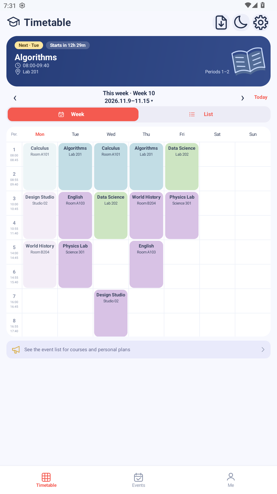
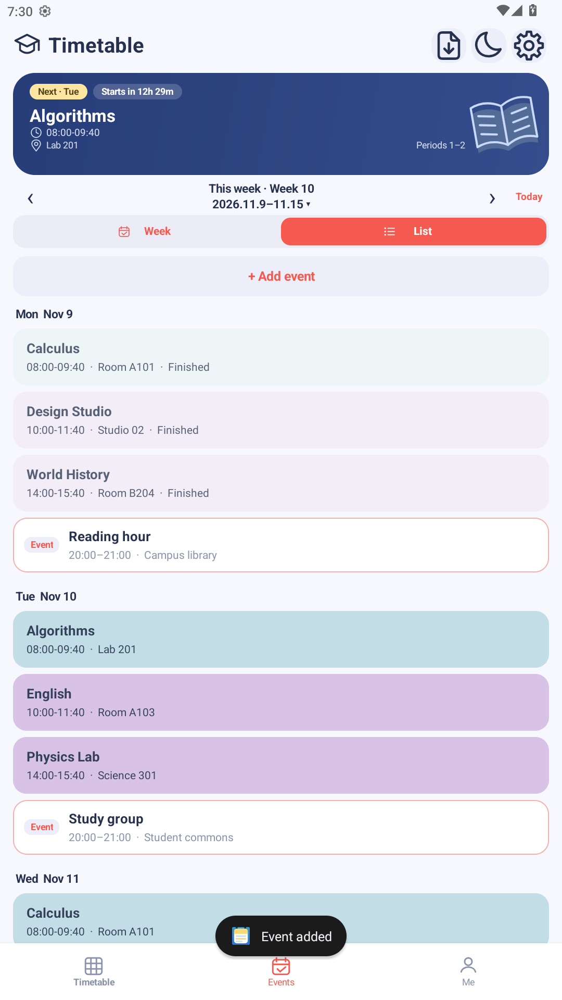
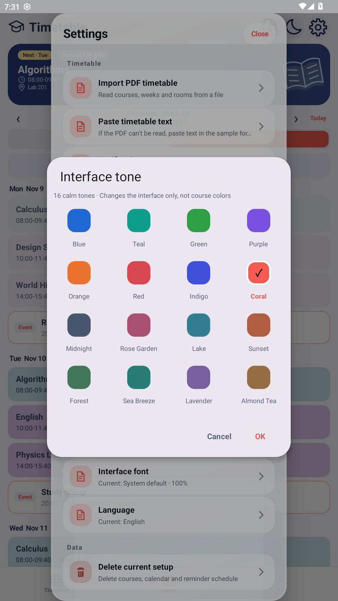

<div align="center">

# Week weeks

**Clean. Ad-free. Keep your attention on the week ahead.**

A native Android timetable and agenda app that works offline. No registration, advertising SDKs, or analytics tracking SDKs.

[简体中文](<README.md>) · [繁體中文](<README.zh-TraditionalChinese.md>) · **English**

[PolyForm Noncommercial 1.0.0](<LICENSE>) · Modifications allowed, commercial use not


</div>

## A timetable, not a distraction

You open your timetable to find your next classroom—not to watch an ad first.

- **Ad-free**: no launch-screen ads, banners, or rewarded videos. No waiting for an ad to finish before checking your classes.
- **No account required**: no phone number, email address, or login. Set your academic calendar and start adding classes.
- **Works offline**: the app does not request the `INTERNET` permission. Viewing your timetable, managing events, and local reminders do not depend on a network connection.
- **No analytics or tracking SDKs**: the current app integrates no advertising, user analytics, or behavioral tracking SDKs.
- **Your data stays on your device**: classes and events are saved in the app's private storage. Cloud sync is not provided.

> “Clean” means the current version is ad-free, has no account system, and includes no analytics tracking. It does not mean zero system permissions. Notification and exact alarm permissions are used only for local reminders; you decide whether to grant them.

## Meet Week weeks

<table>
  <tr>
    <td align="center"><br><strong>Your week of classes, at a glance</strong></td>
    <td align="center"><br><strong>There is life beyond classes</strong></td>
    <td align="center"><br><strong>Interface tones, your choice</strong></td>
  </tr>
</table>

*Images come from a separate demo installation. All classes, locations, and personal events are fictional examples; no real user timetable is included. The screenshot language does not limit the app language: Simplified Chinese, Traditional Chinese, and English are supported.*

## Simple, with the essentials covered

### Timetable: from your next class to the whole semester

- Switch between week and list views, with Monday–Sunday support and classes spanning one or multiple periods.
- Browse teaching weeks, with odd-week, even-week, and custom week selections. Return to the current week with one tap.
- See current and upcoming class cards, countdowns to class start and end, and faded styling for completed classes.
- Customize period times, with 11 periods provided by default. Show teacher names when you need them.
- Tap a class for details, long-press to edit, and long-press an empty timetable cell to add a class—helping prevent accidental edits.

### Agenda: make room for life

- Add one-time personal events with a date, start/end times, location, and notes.
- View classes and personal events by date in “Events,” and manage personal events together in “Me.”
- Choose preset or custom lead times for local reminders. The app can restore reminder schedules after a device restart or app update.

### Import: less repetitive typing

- Import text-based PDF timetables through the system file picker, without requesting broad storage read/write permissions.
- Paste a text timetable, then preview and confirm it before saving.
- PDF parsing depends on the document layout: not every school's format is supported. OCR for scanned documents is not supported.
- Text import currently uses Chinese weekday and period keywords. Changing the interface language does not change the parsing rules.

### Appearance: clean, and personal too

- Light, dark, and system-default themes, with 16 interface accents and 42 preset class colors.
- Classes with the same name share a base color. You can also randomize colors by class-name groups.
- Use the system font or OPPO Sans, and adjust the app's text size from 85% to 125%. The OPPO Sans file is proprietary (about 21.7 MB) and is not redistributed here; place it at `app/src/main/assets/fonts/oppo_sans.ttf` to enable that preset. Without it the preset falls back to the system font and everything else keeps working.
- Three interface languages: Simplified Chinese, Traditional Chinese, and English. The system language is used by default.

## Your data, your device

| Item | Current behavior |
| --- | --- |
| Network | No `INTERNET` permission; no in-app cloud sync |
| Accounts | No registration, login, or phone-number linking |
| Ads and analytics | No advertising or analytics tracking SDKs |
| Classes, personal events, and reminder schedules | Saved using Android Keystore-backed AES/GCM encryption |
| Appearance and other settings | Saved in private app preferences; not all settings are encrypted |
| System backup | App backup is disabled in the configuration; no automatic cloud restore |
| File access | Reads timetable files you explicitly select through the system picker only |

**Keep your original timetable files.** Uninstalling the app or clearing its data removes your local information. Cross-device sync and a complete backup/restore feature are not currently available. Encryption does not make deleted data recoverable, nor does it promise absolute protection on rooted or compromised devices.

Reminders may be affected by notification permissions, exact alarm permissions, and device power-saving policies. When exact alarms are unavailable, the app falls back to less precise scheduling; delivery at the exact same moment cannot be guaranteed on every device. Whether a system file provider itself accesses the network depends on that provider.

## Get started

1. Use a device running **Android 6.0 (API 23) or later** and install a signed APK.
2. On first launch, set the semester's start and end dates.
3. Add classes manually, or import a PDF/text timetable and confirm the preview.
4. If you want reminders, grant the relevant permissions. Adjust appearance and language in Settings.

The official application ID is `com.weekweeks.app`. Development and release builds use the same current interface; there are no separate “original” and “pastel” product editions. The internal `pastel` build is retained only as a compatibility testing entry point, not a separate product version. Data does not migrate automatically between different application IDs, and apps from before the rename are not automatically uninstalled.

The current source version is **1.2.3** (`versionCode 6`). This repository does not assume a download URL. If an APK has not yet been published, you can build it from source as described below.

## Build from source

Prepare **JDK 17**, Android SDK Platform **36.1**, and Build Tools **36.1.0**. The project uses Gradle Wrapper **9.2.0** and Android Gradle Plugin **8.13.0**.

```powershell
# Windows PowerShell: replace these with your local paths
$env:JAVA_HOME="<JDK 17 directory>"
$env:ANDROID_HOME="<Android SDK directory>"
.\gradlew.bat assembleDebug

# Release build and checks
.\gradlew.bat assembleRelease lintRelease testDebugUnitTest testReleaseUnitTest
```

On macOS/Linux, use `./gradlew` and the appropriate environment-variable syntax. Development APKs use debug signing by default; release builds require your own release signing configuration. Without release signing credentials, the build produces an unsigned APK that cannot be installed directly. Building may require network access to download tools and dependencies; **running the app itself does not require a network connection**.

Details: [Building, signing, and verification](<docs/BUILDING.md>) · [Interface and interactions](<docs/PASTEL-UI.md>) · [Changelog](<docs/CHANGELOG.md>)

## Help improve it

Bug reports, suggestions, and translation contributions are welcome. When reporting import issues, provide **anonymized or fictional samples**. Do not submit real student information, teacher details, personal events, signing keys, or passwords.

See [Image notes](<docs/images/README.md>) for image sources and reproduction steps. Demo images in this repository are not examples of real personal data.

## License

This project is licensed under the **[PolyForm Noncommercial License 1.0.0](<LICENSE>)** (SPDX: `PolyForm-Noncommercial-1.0.0`). The [LICENSE](<LICENSE>) file in the repository root is authoritative; the summary below is a reading aid, not a substitute.

**You may**
- Download, install and use it for personal study, research, experiments and hobby projects.
- Modify the source, build on it, and distribute your own modified versions.
- Use it for noncommercial purposes, including at schools, charities, public research organizations and government institutions.

**You may not**
- Use the software or a derivative for commercial purposes, including selling it, charging for distribution, bundling it into a paid product or service, or making it part of a commercial offering.
- Suggest that the author endorses you or your use.
- Remove or work around the license or the `Required Notice:` line.

**When you distribute**: whether or not you changed anything, anyone who receives the software or a derivative from you must also receive these terms (or a link to them) and the `Required Notice:` line. In practice that keeps derivative distributions under the same noncommercial terms.

**This is not an OSI-approved open-source license.** Because commercial use is prohibited, the project is source-available rather than open source. GitHub may report the license as `Other`.

**Third-party components are not covered by this license** and keep their own terms: AndroidX / Material Components (Apache-2.0), the Gradle Wrapper (Apache-2.0), and so on. The OPPO Sans font is not distributed here. Any future third-party asset follows that asset's own license.

**Contributions**: by submitting code or documentation to this repository you agree that your contribution is licensed under these terms, and you confirm you have the right to do so.
