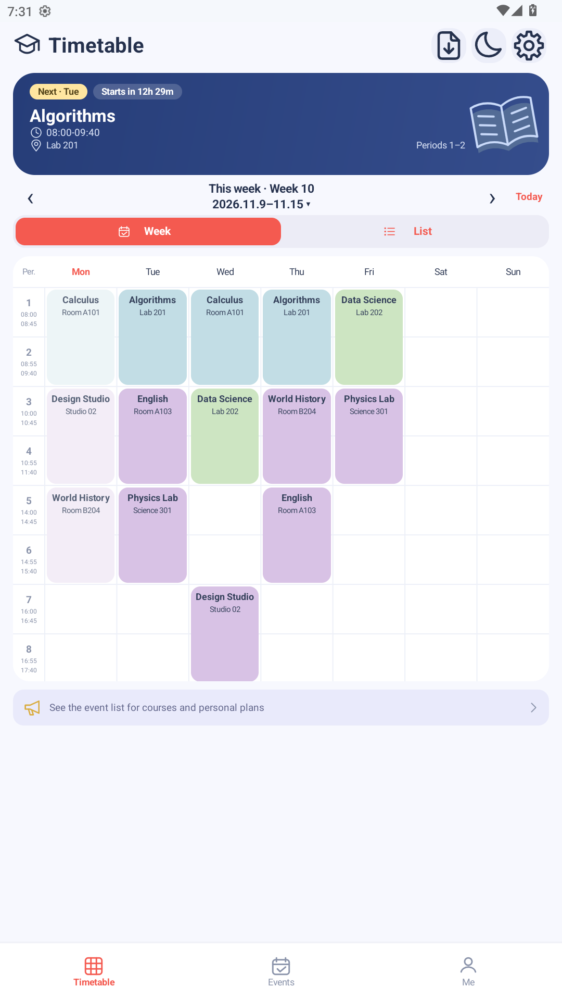
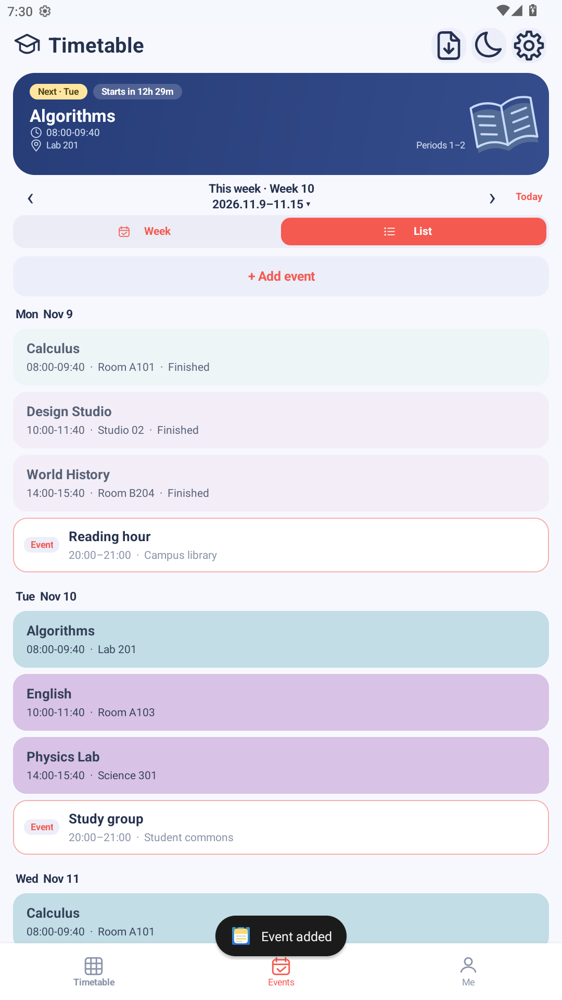
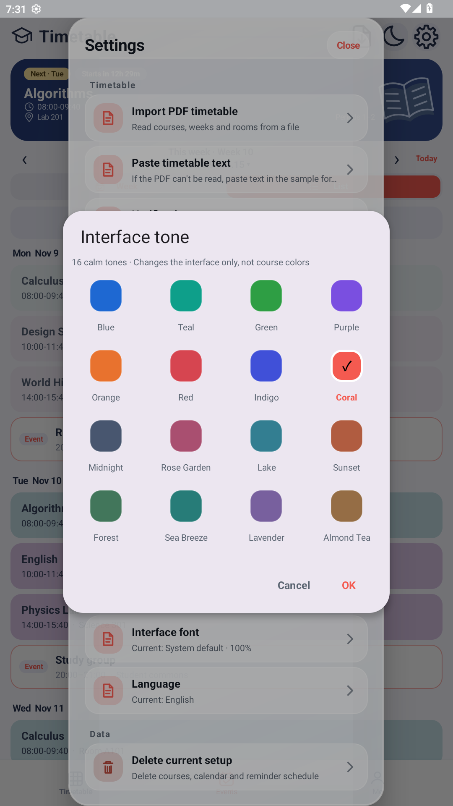

<div align="center">

# Week weeks

**纯净，无广告。把注意力留给每一周。**

一款离线运行的原生 Android 课表与日程应用。无需注册，不接入广告或统计追踪 SDK。

**简体中文** · [繁體中文](<README.zh-TraditionalChinese.md>) · [English](<README.en.md>)

[PolyForm Noncommercial 1.0.0](<LICENSE>) · 允许修改，禁止商业使用


</div>

## 安静地安排课程与生活

打开课表，是为了知道下一节课在哪里，而不是先看一条广告。

- **无广告**：没有开屏广告、横幅广告或激励视频，不用为了查看课表等待广告结束。
- **无需账号**：不需要手机号、邮箱或登录，课程与日程直接在本机管理。
- **离线可用**：应用不申请 `INTERNET` 权限；查课表、管理日程和本地提醒都不依赖网络。
- **无统计追踪 SDK**：当前应用没有集成广告、用户分析或行为追踪 SDK。
- **数据留在设备**：课程与日程保存在应用私有存储中，不提供云同步。

> “纯净”指当前版本无广告、无账号体系、无统计追踪，不代表零系统权限。通知和精确闹钟权限只用于本地提醒，是否授予由你决定。

## 看看 Week weeks

<table>
  <tr>
    <td align="center"><br><strong>一周课程，一眼看清</strong></td>
    <td align="center"><br><strong>课程之外，也有生活</strong></td>
    <td align="center"><br><strong>外观配色，由你决定</strong></td>
  </tr>
</table>

*图片来自独立演示安装，课程、地点及个人安排均为虚构示例，不包含用户的真实课表。截图语言不限制应用语言，应用支持简体中文、繁體中文和 English。*

## 简单，但该有的都有

### 显示内容与查看方式

在「设置 → 显示内容 → 模式选择」决定要显示什么，默认使用综合模式：

| 显示内容 | 用途 |
| --- | --- |
| 课程（课表模式） | 专注课程与教学周 |
| 日程（日程模式） | 专注个人安排，周视图按起止时间排列 |
| 综合（综合模式） | 同时查看课程与个人安排 |

「周视图」与「列表」是同一批内容的两种查看方式；「我的」用于管理个人日程。当前显示内容单独标注为「课程／日程／综合」。切换模式会保留当前日期和查看方式，不删除被隐藏的数据，也不关闭已有提醒。

### 课表：从这一节，到整个学期

- 周视图与列表自由切换，支持周一至周日、单节和跨节课程。
- 按教学周浏览，支持单周、双周与自定义上课周，一键返回本周。
- 当前／下一节课程卡、上课与下课倒计时，以及已上完课程的淡化显示。
- 自定义节次时间，默认提供 11 节；老师姓名可按需显示。
- 点按课程看详情，长按编辑；长按空白课格添加课程，减少误触。

### 日程：给生活留一点位置

- 个人日程可设为一次、每天、工作日（周一至周五）或每周指定星期，可选截止日期（含当天）。编辑重复日程可选「仅本次」或「整个重复日程」。
- 在课程详情选择编辑或长按课卡，可选择「仅本次」调日期、节次、教室或停课，也可编辑整门课程。本次变动会更新课表和提醒。
- 保存课程或日程前会列出与另一类安排重叠的日期、时段和分钟数，可滚动查看全部冲突，再返回修改或继续保存。
- 日程模式的周视图使用时间轴，卡片高度随时长变化；不足 30 分钟或未填写结束时间的安排保留相当于 30 分钟的最小显示高度，实际时间不被改写。
- 重叠安排可并排显示；空间不足时显示数量角标，超过 99 项显示 `99+`，点开仍可选择全部安排。每天的 `＋` 可直接添加当天日程。
- 编辑时实时显示时间范围与时长，并提示「未设结束时间」、时间格式或先后顺序错误；输入不会被自动改写。
- 「列表」按日期展示所选模式的内容，「我的」集中管理个人日程。
- 本地提醒支持预设或自定义提前时间；应用可在开机或升级后恢复排程。

### 导入：少一点重复输入

- 通过系统文件选择器导入 **PDF、XLSX、CSV、TSV、TXT**，不申请广泛的存储读写权限。
- 支持粘贴文本课表；文件和粘贴导入都先预览、确认，再保存。
- XLSX、CSV、TSV 和粘贴文本既支持每行一门课的列表（[XLSX 模板](<docs/templates/timetable-list-template.xlsx>)、[CSV 模板](<docs/templates/timetable-list-template.csv>)），也支持[横排星期、纵排节次的周课表](<docs/IMPORT-PARSERS-20261119.md>)。Excel 可在同一星期列纵向合并连续节次；复制或导出文本时请把连堂节次写成 `1-2`。旧版 `.xls` 需先另存为 XLSX 或 CSV。
- PDF 解析对排版有要求，不是所有学校格式都能识别；不支持扫描件 OCR。
- 支持常见简体、繁体、英文表头及 `周一`／`Mon` 等星期写法；详细格式和限制见 [导入说明](<docs/IMPORT-PARSERS-20261114.md>) 与 [解析兼容性补充](<docs/IMPORT-PARSERS-20261115.md>)。

### 外观：清爽，也可以很个人

- 浅色、深色和跟随系统主题，**22 种界面色调**、42 种课程预设颜色；界面强调色与课程分类颜色独立。
- 同名课程共享基础配色，也可按课程名称分组随机配色。
- 系统字体或 OPPO Sans，应用字号可在 85%–125% 间调整。仓库不附带 OPPO Sans 字体文件（专有字体，约 21.7MB），需要时自行放入 `app/src/main/assets/fonts/oppo_sans.ttf`；缺失时该选项回退为系统字体，不影响其他功能。
- 三种界面语言：简体中文、繁體中文、English；默认跟随系统。

### 设置：连续调整，保留位置

- 按显示、课表、提醒、时间、外观、数据分组，直接展示当前值；窄屏或大字体时名称与当前值上下排列。
- 从模式、主题、字体等子设置确认或取消后返回设置页，保留原滚动位置；主题／字体应用后重建界面、旋转设置父页也会恢复位置。
- 提醒开关与状态说明同步更新；说明文字不伪装成可点击入口。

## 你的数据，你的设备

| 项目 | 当前行为 |
| --- | --- |
| 网络 | 不申请 `INTERNET` 权限，无应用内云同步 |
| 账号 | 无注册、登录或手机号绑定 |
| 广告与统计 | 不集成广告或统计追踪 SDK |
| 课程、个人日程与提醒排程 | 使用 Android Keystore 支持的 AES/GCM 加密保存 |
| 外观等设置 | 保存在应用私有偏好中；并非所有设置都加密 |
| 系统备份 | 配置为禁用应用备份，不提供自动云恢复 |
| 文件访问 | 仅通过系统选择器读取你主动选择的课表文件 |

**请保留原始课表文件。** 卸载应用或清除数据会失去本地资料；目前没有跨设备同步或完整备份／恢复功能。加密不等于可以恢复已删除的数据，也不是对已 root 或受控设备的绝对防护承诺。

提醒可能受到通知权限、精确闹钟权限和设备省电策略影响；精确闹钟不可用时会降级，不能保证每台设备都在同一时刻送达。系统文件提供方本身是否联网，由其自身行为决定。

## 开始使用

1. 使用 **Android 6.0（API 23）或以上**的设备，安装已签名的 APK。
2. 在设置中选择课程、日程或综合模式，再选择周视图或列表。
3. 手动添加课程／日程，或导入课表文件并确认预览；成功导入后会按需引导设置校历，开学日与散学日也可在设置中调整。
4. 如需提醒，再授予相应权限；外观与语言可在设置里调整。

正式应用包名为 `com.weekweeks.app`。开发版与正式版均使用同一套最新界面，不再区分“原版／清新版”；内部 `pastel` 构建仅为兼容测试入口，不是另一个产品版本。不同包名的数据不自动迁移，更名前的旧应用也不会被自动卸载。

当前源码版本为 **1.2.9**（`versionCode 12`）。

下载：[Week weeks 1.2.9 APK](https://github.com/KingRaindrop/Week-weeks/releases/download/v1.2.9/week-weeks-1.2.9.apk) · [GitHub Release 页面](https://github.com/KingRaindrop/Week-weeks/releases/tag/v1.2.9)。也可以按下面的方式自行构建。

官方 APK 不包含本地 OPPO Sans 字体文件；该字体不可用时使用系统字体。

## 本轮更新与验证

v1.2.9 新增单次调课与停课、重复日程和课程／日程冲突提示。Excel、CSV、TSV、TXT 和粘贴文本可以直接识别带星期与节次表头的周课表；文字型 PDF 改善了繁体、全角数字和教室字段兼容性。Debug 和 Release 各通过 **416 项单元测试**，Release Lint 为 **0 错误、7 项既有警告**；MuMu 验证了调课、重复日程、提醒恢复与导入预览。

2026-11-16 的更新完善了内容模式与布局名称、日程时间轴和重叠数量角标、分组设置与原位置返回，以及日程编辑的实时时间反馈。

Debug／Release 各 **368 项单元测试通过**，Lint 各 **0 错误、7 项既有警告**。Android 12／API 32 的独立 audit 安装完成 **993 项界面检查**，并通过模式切换、时间轴、课程布局、导入草稿恢复及提醒弹窗回归；覆盖深浅主题、真实 OPPO Sans、280dp 窄窗口与 200% 字体配置。验证范围与结果见 [本轮记录](<docs/UI-REFINEMENT-20261116.md>)。

## 从源码构建

准备 **JDK 17**、Android SDK Platform **36.1** 和 Build Tools **36.1.0**。项目使用 Gradle Wrapper **9.2.0** 与 Android Gradle Plugin **8.13.0**。

```powershell
# Windows PowerShell：设置成本机实际路径
$env:JAVA_HOME="<JDK 17 目录>"
$env:ANDROID_HOME="<Android SDK 目录>"
.\gradlew.bat assembleDebug

# 正式版与检查
.\gradlew.bat assembleRelease lintRelease testDebugUnitTest testReleaseUnitTest
```

macOS／Linux 使用 `./gradlew` 和相应的环境变量设置方式。开发版 APK 默认使用 debug 签名；正式版需要配置自己的发布签名。没有发布签名时会生成不可直接安装的 unsigned APK。构建过程可能需要联网下载工具与依赖，**应用运行本身不需要网络**。

详细说明：[构建、签名与验证](<docs/BUILDING.md>) · [界面与交互](<docs/PASTEL-UI.md>) · [变更日志](<docs/CHANGELOG.md>)

## 参与改进

欢迎报告问题、提出建议或协助翻译。反馈导入问题时，请提供**脱敏或虚构样例**，不要提交真实学生信息、教师资料、个人日程、签名密钥或密码。

图片素材说明与复现方法见 [图片说明](<docs/images/README.md>)。仓库中演示图片不作为真实个人数据样例。

## 许可证

本项目采用 **[PolyForm Noncommercial License 1.0.0](<LICENSE>)**（SPDX：`PolyForm-Noncommercial-1.0.0`）。全文以仓库根目录的 [LICENSE](<LICENSE>) 为准，下面的中文摘要只帮助理解，不能替代原文。

**你可以**
- 下载、安装、个人使用，包括学习、研究和业余项目。
- 修改源码、二次开发，并把自己的衍生版本分发出去。
- 在学校、公益机构、公共研究机构、政府部门等**非商业**场景使用。

**你不可以**
- 将本软件或其衍生版本用于**商业目的**，包括出售、收费分发、作为付费产品或付费服务的一部分、嵌入商业产品。
- 以本项目名义暗示获得作者背书。
- 移除或绕过许可证与 `Required Notice:` 声明。

**分发时的义务**：无论是否修改过，把软件或其衍生版本再分发给他人时，必须同时提供本许可证（或指向它的链接）以及 `Required Notice:` 行。这实际上要求衍生版本也保持同样的非商业条款。

**这不是 OSI 认证的开源许可证**：因为禁止商业使用，它属于“源码公开（source-available）”。GitHub 的许可证识别可能显示为 `Other`。

**第三方组件不受本许可证约束**，仍遵守各自条款：AndroidX / Material Components（Apache-2.0）、Gradle Wrapper（Apache-2.0）等。OPPO Sans 字体不随仓库分发。若将来的提交包含其他第三方素材，应以该素材自身的许可证为准。

**关于贡献**：向本仓库提交代码或文档，即表示你同意该贡献按本许可证授权，并确认你有权这样做。
