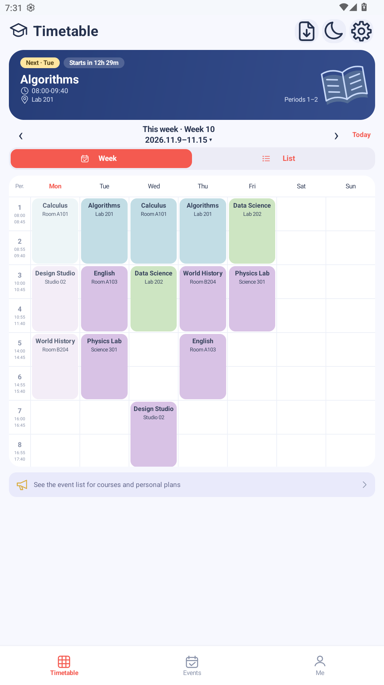
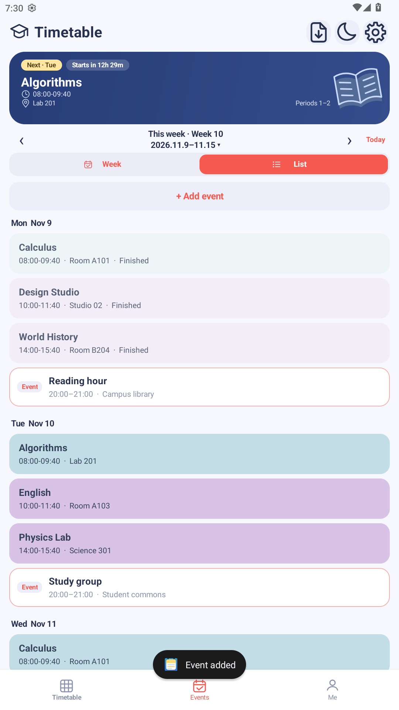
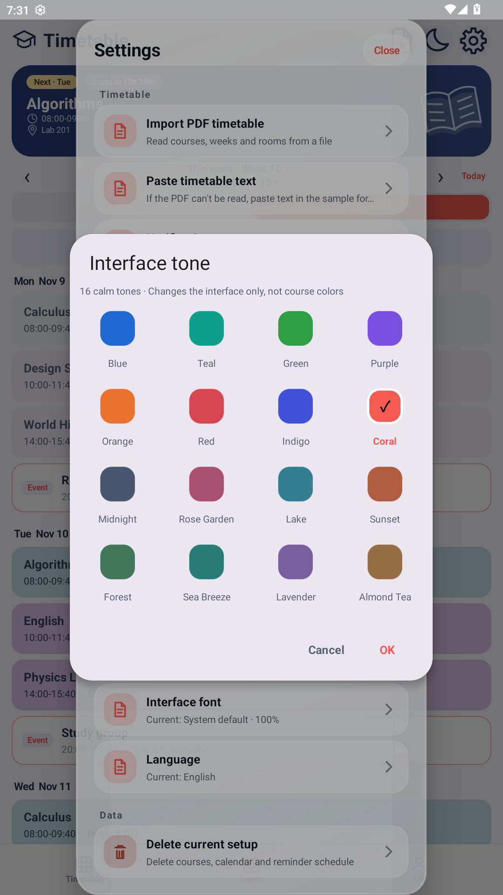

<div align="center">

# Week weeks

**纯净，无广告。把注意力留给每一周。**

一款离线运行的原生 Android 课表与日程应用。无需注册，不接入广告或统计追踪 SDK。

**简体中文** · [繁體中文](<README.zh-TW.md>) · [English](<README.en.md>)


</div>

## 只做课表，不做打扰

打开课表，是为了知道下一节课在哪里，而不是先看一条广告。

- **无广告**：没有开屏广告、横幅广告或激励视频，不用为了查看课表等待广告结束。
- **无需账号**：不需要手机号、邮箱或登录，设置校历后即可添加课程。
- **离线可用**：应用不申请 `INTERNET` 权限；查课表、管理日程和本地提醒都不依赖网络。
- **无统计追踪 SDK**：当前应用没有集成广告、用户分析或行为追踪 SDK。
- **数据留在设备**：课程与日程保存在应用私有存储中，不提供云同步。

> “纯净”指当前版本无广告、无账号体系、无统计追踪，不代表零系统权限。通知和精确闹钟权限只用于本地提醒，是否授予由你决定。

## 看看 Week weeks

<table>
  <tr>
    <td align="center"><br><strong>一周课程，一眼看清</strong></td>
    <td align="center"><br><strong>课程之外，也有生活</strong></td>
    <td align="center"><br><strong>外观配色，由你决定</strong></td>
  </tr>
</table>

*图片来自独立演示安装，课程、地点及个人安排均为虚构示例，不包含用户的真实课表。截图语言不限制应用语言，应用支持简体中文、繁體中文和 English。*

## 简单，但该有的都有

### 课表：从这一节，到整个学期

- 周视图与列表自由切换，支持周一至周日、单节和跨节课程。
- 按教学周浏览，支持单周、双周与自定义上课周，一键返回本周。
- 当前／下一节课程卡、上课与下课倒计时，以及已上完课程的淡化显示。
- 自定义节次时间，默认提供 11 节；老师姓名可按需显示。
- 点按课程看详情，长按编辑；长按空白课格添加课程，减少误触。

### 日程：给生活留一点位置

- 添加一次性的个人安排，支持日期、开始／结束时间、地点和备注。
- 「日程」里按日期查看课程与个人安排，「我的」里集中管理个人日程。
- 本地提醒支持预设或自定义提前时间；应用可在开机或升级后恢复排程。

### 导入：少一点重复输入

- 通过系统文件选择器导入文字型 PDF 课表，不申请广泛的存储读写权限。
- 支持粘贴文本课表，先预览、确认，再保存。
- PDF 解析对排版有要求，不是所有学校格式都能识别；不支持扫描件 OCR。
- 文本导入语法目前使用中文星期／节次关键词，切换界面语言不会改变解析规则。

### 外观：清爽，也可以很个人

- 浅色、深色和跟随系统主题，16 种界面色调、42 种课程预设颜色。
- 同名课程共享基础配色，也可按课程名称分组随机配色。
- 系统字体或 OPPO Sans，应用字号可在 85%–125% 间调整。仓库不附带 OPPO Sans 字体文件（专有字体，约 21.7MB），需要时自行放入 `app/src/main/assets/fonts/oppo_sans.ttf`；缺失时该选项回退为系统字体，不影响其他功能。
- 三种界面语言：简体中文、繁體中文、English；默认跟随系统。

## 你的数据，你的设备

| 项目 | 当前行为 |
| --- | --- |
| 网络 | 不申请 `INTERNET` 权限，无应用内云同步 |
| 账号 | 无注册、登录或手机号绑定 |
| 广告与统计 | 不集成广告或统计追踪 SDK |
| 课程、个人日程与提醒排程 | 使用 Android Keystore 支持的 AES/GCM 加密保存 |
| 外观等设置 | 保存在应用私有偏好中；并非所有设置都加密 |
| 系统备份 | 配置为禁用应用备份，不提供自动云恢复 |
| 文件访问 | 仅通过系统选择器读取你主动选择的课表文件 |

**请保留原始课表文件。** 卸载应用或清除数据会失去本地资料；目前没有跨设备同步或完整备份／恢复功能。加密不等于可以恢复已删除的数据，也不是对已 root 或受控设备的绝对防护承诺。

提醒可能受到通知权限、精确闹钟权限和设备省电策略影响；精确闹钟不可用时会降级，不能保证每台设备都在同一时刻送达。系统文件提供方本身是否联网，由其自身行为决定。

## 开始使用

1. 使用 **Android 6.0（API 23）或以上**的设备，安装已签名的 APK。
2. 首次打开，设置本学期的开学日与散学日。
3. 手动添加课程，或使用 PDF／文本导入并确认预览结果。
4. 如需提醒，再授予相应权限；外观与语言可在设置里调整。

正式应用包名为 `com.weekweeks.app`。开发版与正式版均使用同一套最新界面，不再区分“原版／清新版”；内部 `pastel` 构建仅为兼容测试入口，不是另一个产品版本。不同包名的数据不自动迁移，更名前的旧应用也不会被自动卸载。

当前源码版本为 **1.2.3**（`versionCode 6`）。本仓库不预设下载地址；若项目尚未发布 APK，可按下面的方式自行构建。

## 从源码构建

准备 **JDK 17**、Android SDK Platform **36.1** 和 Build Tools **36.1.0**。项目使用 Gradle Wrapper **9.2.0** 与 Android Gradle Plugin **8.13.0**。

```powershell
# Windows PowerShell：设置成本机实际路径
$env:JAVA_HOME="<JDK 17 目录>"
$env:ANDROID_HOME="<Android SDK 目录>"
.\gradlew.bat assembleDebug

# 正式版与检查
.\gradlew.bat assembleRelease lintRelease testDebugUnitTest testReleaseUnitTest
```

macOS／Linux 使用 `./gradlew` 和相应的环境变量设置方式。开发版 APK 默认使用 debug 签名；正式版需要配置自己的发布签名。没有发布签名时会生成不可直接安装的 unsigned APK。构建过程可能需要联网下载工具与依赖，**应用运行本身不需要网络**。

详细说明：[构建、签名与验证](<docs/BUILDING.md>) · [界面与交互](<docs/PASTEL-UI.md>) · [变更日志](<docs/CHANGELOG.md>)

## 参与改进

欢迎报告问题、提出建议或协助翻译。反馈导入问题时，请提供**脱敏或虚构样例**，不要提交真实学生信息、教师资料、个人日程、签名密钥或密码。

图片素材说明与复现方法见 [图片说明](<docs/images/README.md>)。仓库中演示图片不作为真实个人数据样例。

## 许可证状态

项目希望以开放源码的方式协作，但**当前仓库尚未附带开源许可证**。在维护者选定并加入许可证前，请不要将“源码可查看”理解为已经获得任意使用、修改或再分发的许可。第三方字体等素材仍须遵守各自条款。
