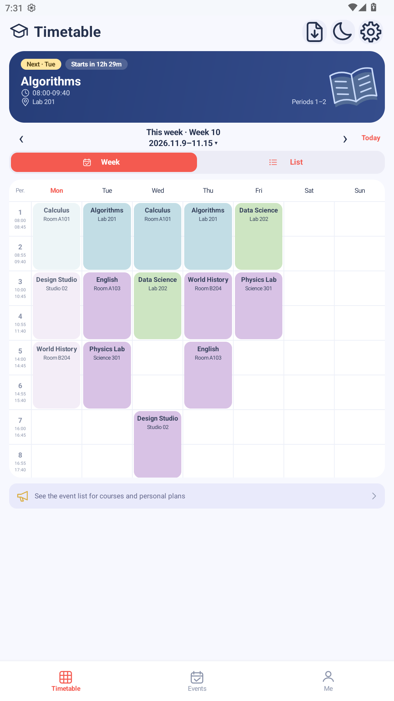
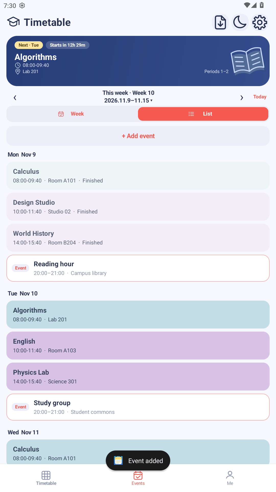
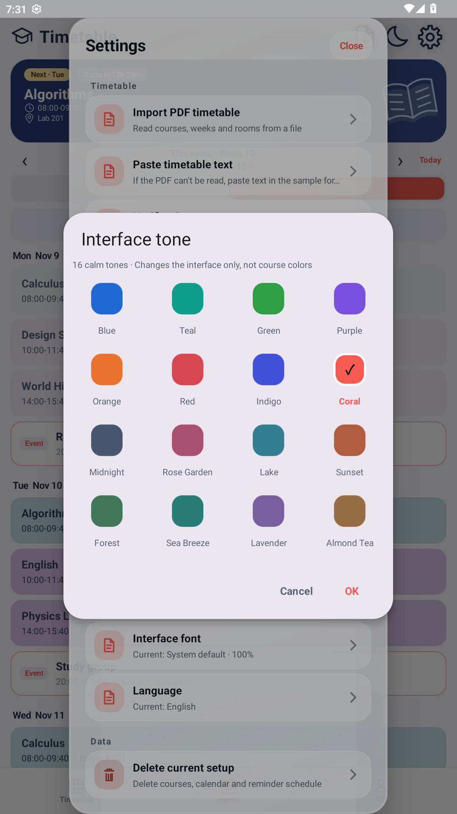

<div align="center">

# Week weeks

**純淨，無廣告。把注意力留給每一週。**

一款離線運作的原生 Android 課表與行程應用程式。無須註冊，不整合廣告或統計追蹤 SDK。

[简体中文](<README.md>) · **繁體中文** · [English](<README.en.md>)


</div>

## 只做課表，不做打擾

打開課表，是為了知道下一堂課在哪裡，而不是先看一則廣告。

- **無廣告**：沒有啟動畫面廣告、橫幅廣告或獎勵影片，不必為了查看課表等待廣告結束。
- **無須帳號**：不需要手機號碼、電子郵件或登入，設定校曆後即可新增課程。
- **離線可用**：應用程式不要求 `INTERNET` 權限；查課表、管理行程和本機提醒都不依賴網路。
- **無統計追蹤 SDK**：目前應用程式未整合廣告、使用者分析或行為追蹤 SDK。
- **資料留在裝置**：課程與行程儲存在應用程式的私人儲存空間中，不提供雲端同步。

> 「純淨」指目前版本無廣告、無帳號系統、無統計追蹤，不代表零系統權限。通知和精確鬧鐘權限僅用於本機提醒，是否授予由你決定。

## 看看 Week weeks

<table>
  <tr>
    <td align="center"><br><strong>一週課程，一眼看清</strong></td>
    <td align="center"><br><strong>課程之外，也有生活</strong></td>
    <td align="center"><br><strong>介面配色，由你決定</strong></td>
  </tr>
</table>

*圖片來自獨立的示範安裝，課程、地點及個人安排均為虛構範例，不包含使用者的真實課表。螢幕截圖的語言不限制應用程式的語言，應用程式支援簡體中文、繁體中文和 English。*

## 簡單，但該有的都有

### 課表：從這一堂，到整個學期

- 週檢視與列表自由切換，支援週一至週日、單節和跨節課程。
- 按教學週瀏覽，支援單週、雙週與自訂上課週，一鍵返回本週。
- 目前／下一堂課程卡、上課與下課倒數計時，以及已上完課程的淡化顯示。
- 自訂節次時間，預設提供 11 節；教師姓名可視需要顯示。
- 輕觸課程查看詳細資訊，長按編輯；長按空白課格新增課程，減少誤觸。

### 行程：給生活留一點位置

- 新增一次性的個人安排，支援日期、開始／結束時間、地點和備註。
- 在「日程」中按日期查看課程與個人安排，在「我的」中集中管理個人行程。
- 本機提醒支援預設或自訂提前時間；應用程式可在開機或更新後恢復排程。

### 匯入：少一點重複輸入

- 透過系統檔案選擇器匯入文字型 PDF 課表，不要求廣泛的儲存空間讀寫權限。
- 支援貼上文字課表，先預覽、確認，再儲存。
- PDF 解析對版面配置有要求，並非所有學校格式都能辨識；不支援掃描檔 OCR。
- 文字匯入語法目前使用中文星期／節次關鍵字，切換介面語言不會改變解析規則。

### 外觀：清爽，也可以很個人

- 淺色、深色和跟隨系統主題，16 種介面色調、42 種課程預設顏色。
- 同名課程共用基本配色，也可按課程名稱分組隨機配色。
- 系統字型或 OPPO Sans，應用程式字級可在 85%–125% 間調整。儲存庫不附帶 OPPO Sans 字型檔（專有字型，約 21.7MB），需要時自行放入 `app/src/main/assets/fonts/oppo_sans.ttf`；缺少時該選項會退回系統字型，不影響其他功能。
- 三種介面語言：簡體中文、繁體中文、English；預設跟隨系統。

## 你的資料，你的裝置

| 項目 | 目前行為 |
| --- | --- |
| 網路 | 不要求 `INTERNET` 權限，無應用程式內雲端同步 |
| 帳號 | 無註冊、登入或手機號碼綁定 |
| 廣告與統計 | 不整合廣告或統計追蹤 SDK |
| 課程、個人行程與提醒排程 | 使用 Android Keystore 支援的 AES/GCM 加密儲存 |
| 外觀等設定 | 儲存在應用程式的私人偏好設定中；並非所有設定都加密 |
| 系統備份 | 已設定為停用應用程式備份，不提供自動雲端還原 |
| 檔案存取 | 僅透過系統選擇器讀取你主動選取的課表檔案 |

**請保留原始課表檔案。** 解除安裝應用程式或清除資料會失去本機資料；目前沒有跨裝置同步或完整備份／還原功能。加密不代表能復原已刪除的資料，也不是對已 root 或遭控制裝置的絕對防護承諾。

提醒可能受到通知權限、精確鬧鐘權限及裝置省電策略影響；精確鬧鐘無法使用時會改用較不精確的排程方式，無法保證每台裝置都在相同時刻送達。系統檔案提供者本身是否連網，取決於其自身行為。

## 開始使用

1. 使用 **Android 6.0（API 23）或以上**的裝置，安裝已簽署的 APK。
2. 首次開啟時，設定本學期的開學日與學期結束日。
3. 手動新增課程，或使用 PDF／文字匯入並確認預覽結果。
4. 如需提醒，再授予相應權限；外觀與語言可在設定中調整。

正式應用程式套件名稱為 `com.weekweeks.app`。開發版與正式版均使用同一套最新介面，不再區分「原版／清新版」；內部 `pastel` 建置僅為相容性測試入口，不是另一個產品版本。不同套件名稱的資料不會自動移轉，更名前的舊應用程式也不會被自動解除安裝。

目前原始碼版本為 **1.2.3**（`versionCode 6`）。本儲存庫不預設下載網址；若專案尚未發布 APK，可依照下列方式自行建置。

## 從原始碼建置

準備 **JDK 17**、Android SDK Platform **36.1** 和 Build Tools **36.1.0**。專案使用 Gradle Wrapper **9.2.0** 與 Android Gradle Plugin **8.13.0**。

```powershell
# Windows PowerShell：設為本機實際路徑
$env:JAVA_HOME="<JDK 17 目錄>"
$env:ANDROID_HOME="<Android SDK 目錄>"
.\gradlew.bat assembleDebug

# 正式版與檢查
.\gradlew.bat assembleRelease lintRelease testDebugUnitTest testReleaseUnitTest
```

macOS／Linux 使用 `./gradlew` 及相應的環境變數設定方式。開發版 APK 預設使用 debug 簽署；正式版需要設定自己的發布簽署資訊。沒有發布簽署資訊時，會產生無法直接安裝的 unsigned APK。建置過程可能需要連網下載工具與相依套件，**應用程式本身的執行不需要網路**。

詳細說明：[建置、簽署與驗證](<docs/BUILDING.md>) · [介面與互動](<docs/PASTEL-UI.md>) · [變更日誌](<docs/CHANGELOG.md>)

## 參與改進

歡迎回報問題、提出建議或協助翻譯。回報匯入問題時，請提供**去識別化或虛構範例**，不要提交真實學生資訊、教師資料、個人行程、簽署金鑰或密碼。

圖片素材說明與重現方式請見[圖片說明](<docs/images/README.md>)。儲存庫中的示範圖片不作為真實個人資料範例。

## 授權狀態

專案希望以開放原始碼的方式協作，但**目前儲存庫尚未附上開源授權條款**。在維護者選定並加入授權條款前，請勿將「原始碼可檢視」理解為已獲得任意使用、修改或再散布的許可。第三方字型等素材仍須遵守各自條款。
