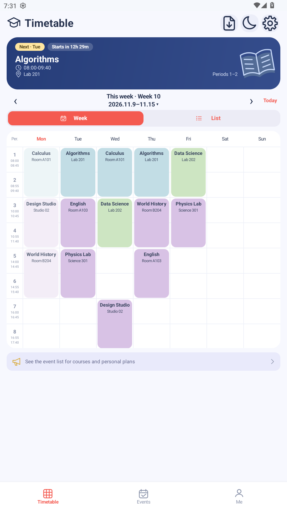
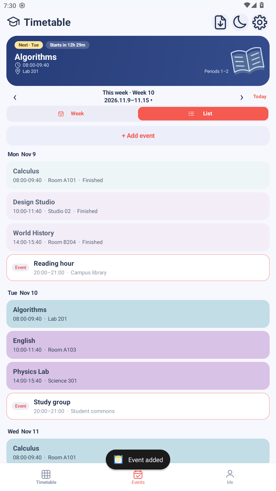
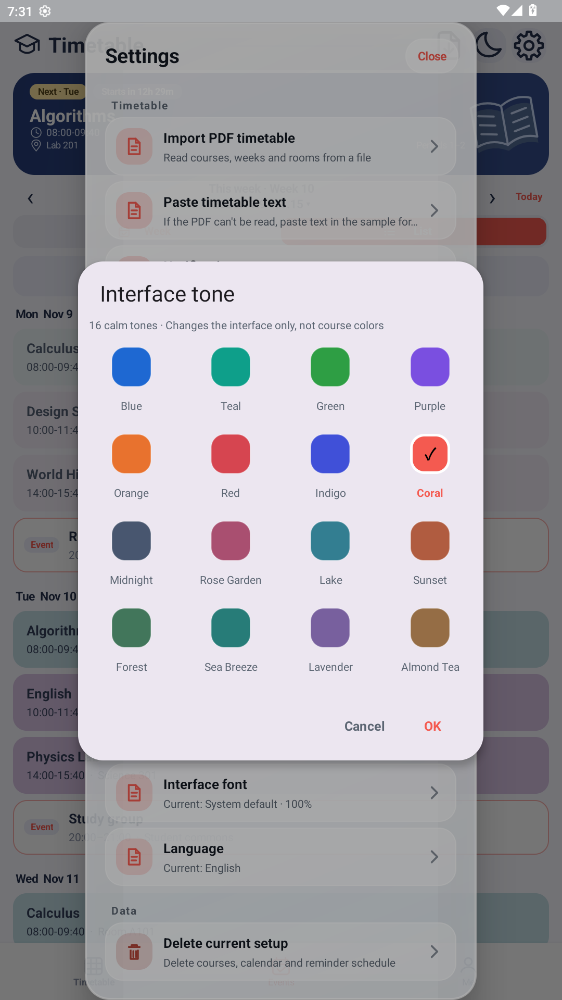

<div align="center">

# Week weeks

**純淨，無廣告。把注意力留給每一週。**

一款離線運作的原生 Android 課表與行程應用程式。無須註冊，不整合廣告或統計追蹤 SDK。

[简体中文](<README.md>) · **繁體中文** · [English](<README.en.md>)

[PolyForm Noncommercial 1.0.0](<LICENSE>) · 允許修改，禁止商業使用


</div>

## 只做課表，不做打擾

打開課表，是為了知道下一堂課在哪裡，而不是先看一則廣告。

- **無廣告**：沒有啟動畫面廣告、橫幅廣告或獎勵影片，不必為了查看課表等待廣告結束。
- **無須帳號**：不需要手機號碼、電子郵件或登入，設定校曆後即可新增課程。
- **離線可用**：應用程式不要求 `INTERNET` 權限；查課表、管理行程和本機提醒都不依賴網路。
- **無統計追蹤 SDK**：目前應用程式未整合廣告、使用者分析或行為追蹤 SDK。
- **資料留在裝置**：課程與行程儲存在應用程式的私人儲存空間中，不提供雲端同步。

> 「純淨」指目前版本無廣告、無帳號系統、無統計追蹤，不代表零系統權限。通知和精確鬧鐘權限僅用於本機提醒，是否授予由你決定。

## 看看 Week weeks

<table>
  <tr>
    <td align="center"><br><strong>一週課程，一眼看清</strong></td>
    <td align="center"><br><strong>課程之外，也有生活</strong></td>
    <td align="center"><br><strong>介面配色，由你決定</strong></td>
  </tr>
</table>

*圖片來自獨立的示範安裝，課程、地點及個人安排均為虛構範例，不包含使用者的真實課表。螢幕截圖的語言不限制應用程式的語言，應用程式支援簡體中文、繁體中文和 English。*

## 簡單，但該有的都有

### 選擇顯示內容與查看方式

在「設定 → 顯示內容 → 模式選擇」決定畫面顯示哪些內容，預設使用綜合模式；課表上方會標示目前的選擇。

| 顯示內容 | 畫面內容 |
| --- | --- |
| 課程（課表模式） | 學期課表中的課程 |
| 日程（日程模式） | 個人行程，也可瀏覽學期外的日期 |
| 綜合 | 同時顯示課程與個人行程 |

**週視圖**和**列表**決定目前模式的呈現方式。切換模式會保留目前日期與查看方式，以及已儲存的課程、行程與提醒。「我的」則可集中管理個人行程。

### 課表：從這一堂，到整個學期

- 週視圖與列表自由切換，支援週一至週日、單節和跨節課程。
- 按教學週瀏覽，支援單週、雙週與自訂上課週，一鍵返回本週。
- 目前／下一堂課程卡、上課與下課倒數計時，以及已上完課程的淡化顯示。
- 自訂節次時間，預設提供 11 節；教師姓名可視需要顯示。
- 輕觸課程查看詳細資訊，長按編輯；長按空白課格新增課程，減少誤觸。

### 行程：給生活留一點位置

- 個人日程可設為單次、每天、工作日（週一至週五）或每週指定星期，可選截止日期（含當天）。編輯時可選「僅本次」或「整個重複日程」。
- 在課程詳情選擇編輯或長按課卡，可選擇單次調整日期、節次、教室或停課，也可編輯整門課程。提醒跟隨實際日期與地點。
- 儲存課程或行程前會列出與另一類安排重疊的日期、時段和分鐘數，可捲動查看所有衝突，再返回修改或繼續儲存。
- 日程模式的週視圖使用共用時間軸，卡片高度隨時長變化。短行程或未設結束時間的行程保留相當於 30 分鐘的最小顯示高度，不改變已儲存的時間。
- 重疊行程在空間足夠時並排顯示；空間不足時以數量角標分組，點按即可從該組全部行程中選擇。超過 99 項時顯示 `99+`。
- 每一天都有對應日期的新增按鈕；列表依時間順序顯示所選內容。
- 編輯時即時顯示時間範圍、時長或「未設結束時間」；無效時間，以及結束時間早於或等於開始時間的情況，會在輸入欄位旁提示。
- 本機提醒支援預設或自訂提前時間；應用程式可在開機或更新後恢復排程。

### 匯入：少一點重複輸入

- 透過系統檔案選擇器匯入文字型 **PDF、XLSX、CSV、TSV 或 TXT** 課表，不要求廣泛的儲存空間讀寫權限；也支援直接貼上文字。
- 先預覽解析結果，逐項檢查課程，確認後再儲存。
- 試算表、分隔文字和貼上匯入皆支援每列一門課的清單（[XLSX 範本](<docs/templates/timetable-list-template.xlsx>)、[CSV 範本](<docs/templates/timetable-list-template.csv>)），也支援[橫排星期、縱排節次的週課表](<docs/IMPORT-PARSERS-20261119.md>)。XLSX 可在同一星期欄內垂直合併連續節次；複製或匯出成文字時，連堂節次請寫成 `1-2`。
- 支援常見簡體、繁體、英文表頭及 `週一`／`Mon` 等星期寫法；詳細格式與限制見[匯入說明](<docs/IMPORT-PARSERS-20261114.md>)及[解析相容性補充](<docs/IMPORT-PARSERS-20261115.md>)。
- 舊版 `.xls` 需先另存為 XLSX 或 CSV；不會自動辨識任意視覺格狀課表。PDF 解析對版面配置有要求，不支援掃描檔 OCR。

### 外觀：清爽，也可以很個人

- 淺色、深色和跟隨系統主題，**22 種介面色調**、42 種課程預設顏色；介面強調色與課程分類顏色獨立。
- 同名課程共用基本配色，也可按課程名稱分組隨機配色。
- 系統字型或 OPPO Sans，應用程式字級可在 85%–125% 間調整。儲存庫不附帶 OPPO Sans 字型檔（專有字型，約 21.7MB），需要時自行放入 `app/src/main/assets/fonts/oppo_sans.ttf`；缺少時該選項會退回系統字型，不影響其他功能。
- 三種介面語言：簡體中文、繁體中文、English；預設跟隨系統。

### 設定：調整後接著操作

- 設定分為顯示、課表、提醒、時間、外觀和資料；項目顯示目前值，說明放在群組下方。
- 主題、字型及顯示模式等子設定確認或取消後，會返回設定頁原來的位置；套用主題或字型造成畫面重建，以及旋轉設定頁時，也會保留位置。
- 窄螢幕或大字體下，項目名稱與目前值會改為上下排列。切換提醒開關後，通知狀態與無障礙描述會立即更新。

## 你的資料，你的裝置

| 項目 | 目前行為 |
| --- | --- |
| 網路 | 不要求 `INTERNET` 權限，無應用程式內雲端同步 |
| 帳號 | 無註冊、登入或手機號碼綁定 |
| 廣告與統計 | 不整合廣告或統計追蹤 SDK |
| 課程、個人行程與提醒排程 | 使用 Android Keystore 支援的 AES/GCM 加密儲存 |
| 外觀等設定 | 儲存在應用程式的私人偏好設定中；並非所有設定都加密 |
| 系統備份 | 已設定為停用應用程式備份，不提供自動雲端還原 |
| 檔案存取 | 僅透過系統選擇器讀取你主動選取的課表檔案 |

**請保留原始課表檔案。** 解除安裝應用程式或清除資料會失去本機資料；目前沒有跨裝置同步或完整備份／還原功能。加密不代表能復原已刪除的資料，也不是對已 root 或遭控制裝置的絕對防護承諾。

提醒可能受到通知權限、精確鬧鐘權限及裝置省電策略影響；精確鬧鐘無法使用時會改用較不精確的排程方式，無法保證每台裝置都在相同時刻送達。系統檔案提供者本身是否連網，取決於其自身行為。

## 開始使用

1. 使用 **Android 6.0（API 23）或以上**的裝置，安裝已簽署的 APK。
2. 在設定中確認本學期的開學日與學期結束日；課表匯入成功後，若尚未設定校曆，也會引導設定。
3. 手動新增課程或行程，或匯入支援的課表檔案／貼上文字並確認預覽結果。
4. 選擇課程、日程或綜合內容，再使用週視圖或列表查看。如需提醒，再授予相應權限；外觀與語言也可在設定中調整。

正式應用程式套件名稱為 `com.weekweeks.app`。開發版與正式版均使用同一套最新介面，不再區分「原版／清新版」；內部 `pastel` 建置僅為相容性測試入口，不是另一個產品版本。不同套件名稱的資料不會自動移轉，更名前的舊應用程式也不會被自動解除安裝。

目前原始碼版本為 **1.2.9**（`versionCode 12`）。

下載：[Week weeks 1.2.9 APK](https://github.com/KingRaindrop/Week-weeks/releases/download/v1.2.9/week-weeks-1.2.9.apk) · [GitHub Release 頁面](https://github.com/KingRaindrop/Week-weeks/releases/tag/v1.2.9)。也可以依照下列方式自行建置。

官方 APK 不包含本機 OPPO Sans 字型檔；該字型無法使用時會採用系統字型。

## 本輪更新與驗證

v1.2.9 新增單次調課與停課、重複行程，以及課程與行程衝突提示。XLSX、CSV、TSV、TXT 和貼上文字可直接辨識含星期表頭與節次欄的週課表；文字型 PDF 改善了繁體、全形數字和教室欄位相容性。Debug 與 Release 各通過 **416 項單元測試**，Release Lint 為 **0 錯誤、7 項既有警告**；MuMu 已驗證調課、重複行程、提醒復原與匯入預覽。

2026 年 11 月 16 日的更新改善了行程時間軸、重疊項目選擇、分組設定、子設定返回位置及時間編輯回饋。Debug 與 Release 各通過 **368 項單元測試**；兩份 lint 報告均為 **0 錯誤、7 項既有警告**。隔離套件的介面裝置回歸通過 **993 項檢查**，模式切換、時間軸及提醒流程回歸也已通過。

裝置驗證使用獨立 audit 套件與 MuMu Android 12（API 32），未涵蓋所有 Android 版本與廠牌。驗證範圍與限制詳見[介面優化報告](<docs/UI-REFINEMENT-20261116.md>)。

## 從原始碼建置

準備 **JDK 17**、Android SDK Platform **36.1** 和 Build Tools **36.1.0**。專案使用 Gradle Wrapper **9.2.0** 與 Android Gradle Plugin **8.13.0**。

```powershell
# Windows PowerShell：設為本機實際路徑
$env:JAVA_HOME="<JDK 17 目錄>"
$env:ANDROID_HOME="<Android SDK 目錄>"
.\gradlew.bat assembleDebug

# 正式版與檢查
.\gradlew.bat assembleRelease lintRelease testDebugUnitTest testReleaseUnitTest
```

macOS／Linux 使用 `./gradlew` 及相應的環境變數設定方式。開發版 APK 預設使用 debug 簽署；正式版需要設定自己的發布簽署資訊。沒有發布簽署資訊時，會產生無法直接安裝的 unsigned APK。建置過程可能需要連網下載工具與相依套件，**應用程式本身的執行不需要網路**。

詳細說明：[建置、簽署與驗證](<docs/BUILDING.md>) · [介面與互動](<docs/PASTEL-UI.md>) · [變更日誌](<docs/CHANGELOG.md>)

## 參與改進

歡迎回報問題、提出建議或協助翻譯。回報匯入問題時，請提供**去識別化或虛構範例**，不要提交真實學生資訊、教師資料、個人行程、簽署金鑰或密碼。

圖片素材說明與重現方式請見[圖片說明](<docs/images/README.md>)。儲存庫中的示範圖片不作為真實個人資料範例。

## 授權條款

本專案採用 **[PolyForm Noncommercial License 1.0.0](<LICENSE>)**（SPDX：`PolyForm-Noncommercial-1.0.0`）。全文以儲存庫根目錄的 [LICENSE](<LICENSE>) 為準，以下中文摘要僅供理解，不能取代原文。

**你可以**
- 下載、安裝、個人使用，包括學習、研究與業餘專案。
- 修改原始碼、二次開發，並散布自己的衍生版本。
- 在學校、公益機構、公共研究機構、政府部門等**非商業**場景使用。

**你不可以**
- 將本軟體或其衍生版本用於**商業目的**，包括販售、收費散布、作為付費產品或付費服務的一部分、嵌入商業產品。
- 以本專案名義暗示獲得作者背書。
- 移除或規避授權條款與 `Required Notice:` 聲明。

**散布時的義務**：無論是否修改過，把軟體或其衍生版本再散布給他人時，必須同時提供本授權條款（或指向它的連結）以及 `Required Notice:` 行。這實際上要求衍生版本也維持相同的非商業條款。

**這不是 OSI 認證的開源授權**：因為禁止商業使用，它屬於「原始碼公開（source-available）」。GitHub 的授權辨識可能顯示為 `Other`。

**第三方元件不受本授權約束**，仍遵守各自條款：AndroidX / Material Components（Apache-2.0）、Gradle Wrapper（Apache-2.0）等。OPPO Sans 字型不隨儲存庫散布。若將來的提交包含其他第三方素材，應以該素材自身的授權為準。

**關於貢獻**：向本儲存庫提交程式碼或文件，即表示你同意該貢獻依本授權條款授權，並確認你有權這樣做。
